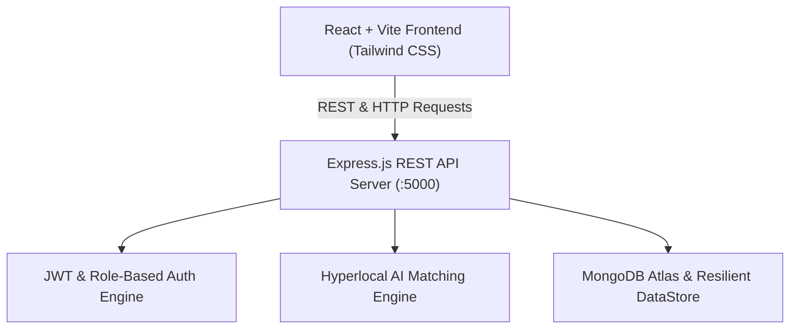

# NEXORA — Architecture & Technical Specifications

## 1. System Overview
NEXORA is an AI-assisted hyperlocal marketplace and community platform connecting residents with vetted, verified local professionals (electricians, plumbers, home cleaners, carpenters, etc.). Built on the MERN stack with modern Tailwind CSS tokens adhering to the approved Deep Forest Green visual identity.

## 2. Technology Stack
- **Frontend**: React 18, Vite, Tailwind CSS with customized forest green design tokens, Lucide React icons, React Router v6.
- **Backend**: Node.js v24, Express.js REST API, Helmet security headers, Express Rate Limiter, CORS with credentials.
- **Database**: Mongoose models (Users, ProviderProfiles, Services, Bookings, Reviews, Conversations, Commissions, Disputes, AuditLogs) backed by a resilient data storage engine.
- **Authentication**: Real bcrypt password hashing, signed JWT tokens, SMS OTP verification flow, OAuth identity hooks.
- **AI Matching**: Natural language intent extractor, constraint resolver, and multi-factor scoring engine (40% category, 25% locality, 20% rating, 15% budget).

## 3. Security & Governance
- Role-Based Access Control (`customer`, `provider`, `admin`) strictly validated on backend routes.
- Resource ownership checks prevent cross-account modifications of bookings and services.
- Reviews strictly restricted to completed bookings with duplicate prevention.
- Transparent price snapshots stored at booking creation to prevent mid-flight price manipulation.
- Platform fee (10%) calculated and stored in immutable commission ledgers.
